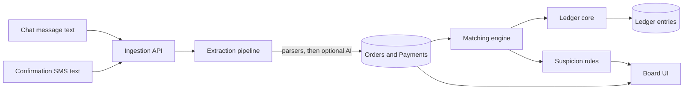

# Design: chat-ledger

## Overview

Java 21, Spring Boot, PostgreSQL. Server-rendered UI with Thymeleaf and HTMX, so the
page stays light on slow phones. The ledger is its own Maven module with no web
dependency, so it can be reused later.

## Architecture



## Modules

| Module | Responsibility | Depends on |
|---|---|---|
| `ledger-core` | Accounts, immutable entries, balance invariant, reversals | nothing |
| `ingestion` | Endpoints, idempotency, input validation, HMAC | `extraction` |
| `extraction` | Order parser, SMS templates, optional AI extractor, validator | nothing |
| `matching` | Scoring, thresholds, partial and over payments, overrides | `ledger-core` |
| `suspicion` | Rule set that produces flags with reasons | `matching` |
| `web` | Board, simulators, exports, auth | all |

## Data model (main tables)

- `tenant(id, name, currency, scale, slug UNIQUE, disabled_at)` (`slug` and `disabled_at` arrive with task 3)
- `app_user(id, tenant_id, email lower-case, password_hash, role, disabled_at)`, unique per (tenant, email)
- `customer(id, tenant_id, display_name, phone_hash, phone_last4)`
- `orders(id, tenant_id, external_id UNIQUE per tenant, customer_id, total_minor, currency, status, raw_text, created_at)`
- `order_line(id, tenant_id, order_id, label, qty, unit_minor)` (`tenant_id` added in task 3, see "Tenancy and authentication")
- `payment(id, tenant_id, provider, tx_id UNIQUE per tenant+provider, amount_minor, currency, sender_name, sender_last4, paid_at, status, raw_text)`
- `match(id, tenant_id, order_id, payment_id, amount_minor, score, reasons_json, state, decided_by, decided_at)` (`tenant_id` added in task 3)
- `flag(id, tenant_id, subject_type, subject_id, code, reason, created_at, resolved_at)`
- `account(id, tenant_id, code, name, type)`
- `ledger_txn(id, tenant_id, kind, ref_type, ref_id, reverses_txn_id UNIQUE, created_at)`; a reversal points at the transaction it undoes, in the same tenant (V009)
- `ledger_entry(id, txn_id, account_id, debit_minor, credit_minor)` with a check that one of the two is zero, and no UPDATE or DELETE allowed by the application role.
- `audit_log(id, tenant_id, actor, action, subject, at)`

Default accounts: Accounts receivable, Mobile money clearing, Sales revenue, Customer credit (overpayments).

## Order and payment states

- Order: `PENDING_PAYMENT`, `PARTIALLY_PAID`, `PAID`, `NEEDS_REVIEW`, `UNPARSED`, `CANCELLED`
- Payment: `RECEIVED`, `MATCHED`, `UNMATCHED`, `DUPLICATE`, `UNVERIFIED`, `UNPARSED`
- Match: `AUTO`, `SUGGESTED`, `CONFIRMED`, `REJECTED`, `REVERSED`

## Ledger postings

- Order accepted: debit Accounts receivable, credit Sales revenue.
- Payment matched: debit Mobile money clearing, credit Accounts receivable (up to the order balance).
- Excess: debit Mobile money clearing, credit Customer credit.
- Unmatch: a reversal transaction that mirrors the original, never an edit.

## Matching score (initial weights, tunable)

| Signal | Points |
|---|---|
| Amount equals order balance | 50 |
| Reference code in the confirmation equals the order code | 25 |
| Sender name similarity to customer (normalized, accent-insensitive) | 15 |
| Timestamp within the expected window after the order | 10 |

Thresholds: score >= 85 auto-match; 60 to 84 suggest; below 60 leave unmatched.
Every candidate keeps its list of reasons so the UI can say why.

## Extraction pipeline

1. Normalize text (whitespace, digits, accents, common separators).
2. Orders: try each parser in order, first valid result wins. Payments: scan **every** template over the whole message; if more than one
   matches and they do not give the same result, the message is `UNPARSED` (`AMBIGUOUS_TEMPLATE`). Template order never decides money.
3. If none match and an AI extractor is configured, call it with a timeout and a JSON schema.
4. Validate: amount appears in the source text, currency known, date plausible. Reject otherwise.
5. Never pass phone numbers or names to an external service unless the operator has enabled it.

The default deployment has no AI extractor. A free host cannot run a local model, so the
live demo relies on deterministic parsers. The AI extractor stays behind an interface
and can point at any compatible endpoint.

## Provider templates

Templates are data, not code, and they are **literal text with typed holes, not regular expressions**: for example
`You received {amount} {currency} from {senderName} ({senderPhone}). Txn {transactionId}. {paidAt}`.
A template file (JSON) carries: id, provider code, currency, scale, whether a transaction id is required, a fixed UTC offset, a numeric
date format, the template text, at least three examples (with the fields they must give) and at least five counter-examples (texts that
must not match). Holes: `amount`, `currency`, `senderName`, `senderPhone` (or `senderLast4`), `transactionId`, `paidAt`, `reference`.
The demo ships five **synthetic** templates for two formats ("ProviderA", "ProviderB") and a forwarded shape. Templates ship in the jar;
adding one needs a release (see register item 35). Do not copy real operator wording into the repository.

## API (JSON, signed)

- `POST /api/v1/messages/order` body: `externalId`, `text`
- `POST /api/v1/messages/payment` body: `externalId`, `text`
- `GET /api/v1/board`
- `POST /api/v1/matches/{id}/confirm`, `/reject`, `/reverse`
- `GET /api/v1/export/ledger.csv`

Headers: `X-Signature` (HMAC-SHA256 over the body), `X-Tenant`. Idempotency by `externalId`.

`X-Tenant` is request input, so it must not decide whose data is touched. It only names
which signing key to verify with. The effective tenant is the tenant that owns the key that
verified the signature; a mismatch is rejected (task 11). See "Tenancy and authentication".

## Suspicion rules

Each rule is a small class returning zero or more flags with a code and a plain reason:
`DUPLICATE_TX`, `NO_PROVIDER_ID`, `AMOUNT_NEAR_MISS`, `NAME_MISMATCH`, `TIME_ANOMALY`,
`SENDER_ALIAS`. Rules are independent and individually testable.

## Other security rules

- Phone numbers stored hashed with a per-tenant salt plus the last 4 digits for display.
- Secrets from environment variables only. A pre-commit secret scan.
- The demo tenant is read-write on synthetic data and reset on a schedule.

Everything about tenants, login, sessions, roles, request limits and headers is in the next
section. Status: **proposed, awaiting approval** (task 3, requirement 9).

## Tenancy and authentication

Security steering applies: security outranks speed, scope and elegance, and every defense
that is weakened is named in "Trade-offs and weakened defenses" with its compensation.

### Threat model

- An anonymous visitor guessing workspaces, emails and passwords.
- A signed-in user of tenant A (SELLER or HELPER) trying to reach tenant B, or to do what
  their role forbids.
- A bug in our own code: a forgotten `WHERE tenant_id = ?`, or a tenant id taken from the wrong place.
- A stolen database backup (password hashes).
- Out of scope for task 3 and named as not done: multi-factor authentication, password
  reset, single sign-on, "remember me", a hostile operator.

### What was checked while writing this

Checked against documentation: PostgreSQL says foreign-key and unique checks always bypass
row security and that table owners, superusers and `BYPASSRLS` roles bypass it too (owners
unless `FORCE ROW LEVEL SECURITY`); a table with RLS enabled and no policy denies everything;
`TRUNCATE` and `REFERENCES` are not subject to RLS. OWASP's Argon2id minimum is 19 MiB, 2 passes,
1 lane. Spring's `Argon2PasswordEncoder` needs BouncyCastle, which the Boot BOM does not manage
(latest release on Maven Central: 1.86). htmx ships with `allowEval`, `allowScriptTags` and
`includeIndicatorStyles` on, and documents `hx-headers` for CSRF tokens.

Not yet verified, to be proven by tests in phase 2 and not assumed: that the transaction-local
tenant setting is still readable when a deferred constraint trigger fires at commit; the exact
Spring Boot 4.1 and Spring Security 7.1 property and API names; Spring's own Argon2 default
parameters (so explicit ones are used); whether BouncyCastle 1.86 carries advisories.

### Defects in the current schema that this design must fix

These come from reading V001-V009 against row-level security. None can be fixed by editing an
old migration, so each is fixed by a new one.

1. **V009's tenant trigger fails open under RLS.** `ledger_assert_entry_tenant` steps aside when
   it cannot see the account or the transaction, expecting the foreign key to report it. Under
   RLS another tenant's account is invisible, so the trigger steps aside, and foreign-key checks
   bypass RLS, so the entry commits. The function must treat "cannot see it" as a violation.
2. **Foreign keys can cross tenants.** Because FK checks bypass RLS, `orders.customer_id`,
   `order_line.order_id`, `match.order_id`, `match.payment_id` and the `decided_by`/`actor`
   columns accept another tenant's id if the caller knows the UUID. Each becomes a composite
   foreign key that includes `tenant_id`, as V009 already did for reversals.
3. **`order_line`, `match` and `ledger_entry` have no tenant column.** And `match` can link an
   order of tenant A to a payment of tenant B today.

### Decision 1: login and tenancy

`app_user` is unique per (tenant, email), so a login must say which tenant.

| Option | What | Cost |
|---|---|---|
| A. Workspace code | Login form has workspace, email, password. `tenant.slug` is a short public code. | One more field. The slug is an identifier, not a secret, so identical responses are needed to stop it being probed. New unique column. |
| B. Globally unique email | Change the unique key to `email` alone. | One person cannot work for two sellers without two emails. "Email already used" at user creation reveals accounts across tenants. Reusing the address after someone leaves is awkward. Changes V002's key. |
| C. Email first, then pick | Look the email up across all tenants, then ask which one. | Needs a query across tenants (an RLS exception). Reveals which tenants an email belongs to. |

**Recommendation: A.** It is the only option that needs no cross-tenant query and leaks nothing by design.

Slug: 3 to 32 characters, `[a-z0-9-]`, starts and ends alphanumeric, a short reserved list
(`admin`, `api`, `login`, `logout`, `static`, `health`). Email: trimmed, lower-cased with
`Locale.ROOT`, at most 254 characters, stored lower-case with a `CHECK`.

```mermaid
sequenceDiagram
  participant B as Browser
  participant F as Login chain
  participant DB as PostgreSQL
  B->>F: POST /login (workspace, email, password, CSRF token)
  F->>F: body size limit, rate limit by IP and by account key
  F->>DB: resolve_tenant_for_login(slug)
  alt workspace unknown or disabled
    F->>DB: same user lookup, with a random tenant id
    F->>F: verify the password against a dummy hash
  else workspace known
    F->>DB: set tenant for the transaction, find user by email (RLS applies)
    F->>F: verify the password (Argon2id)
  end
  F-->>B: failure: the same redirect and page every time
  F-->>B: success: new session id; tenant and role come from the database row
```

Pre-login lookup, without leaking tenants or users:

- The only privileged step is `resolve_tenant_for_login(slug) -> uuid`, a `SECURITY DEFINER`
  function that reads only `tenant`, returns only the id (or NULL), has a fixed `search_path`,
  and is executable by the application role alone. The user lookup then runs as normal, under RLS,
  for that tenant. There is no endpoint that lists workspaces or checks an email.
- Unknown workspace, unknown email, wrong password and disabled account give one response:
  same status, same redirect, same page, no distinguishing text. On an unknown workspace the
  same database work and a dummy password verification still run, so response time does not
  separate the cases. A small timing difference of a few milliseconds is a residual risk.
- Throttling (429) keys on what was submitted (workspace plus email, hashed), whether or not the
  account exists, so it is not an existence oracle.
- The principal's tenant, user id and role come from the database row, never from the form.
- No account lockout. Lockout lets anyone lock a seller out and can reveal an account; throttling is used instead.

### Decision 2: tenant isolation in depth

| Option | What | Cost |
|---|---|---|
| A. Application scoping only | Every query filters by tenant. | One missed filter is a data leak, and nothing else catches it. |
| B. Application scoping plus RLS | As A, plus PostgreSQL policies driven by a per-transaction setting. | Policies on every tenant table, a tenant transaction wrapper, some query overhead, and the defects listed above must be fixed first. |
| C. Per-tenant roles or schemas | The database itself separates tenants. | A role or schema per seller: migrations, pooling and operations all become much harder. Out of proportion for this product. |

**Recommendation: B.**

Layer 1, application. The tenant id is taken only from the authenticated principal (`CurrentTenant`).
A controller never accepts a tenant id from a path, parameter, body or header. A test scans every
controller handler and request type for a parameter or field named like a tenant and fails the
build on a match. Repositories keep taking the tenant id explicitly (the ledger already does).

Layer 2, PostgreSQL row-level security.

- `app_current_tenant()` returns `NULLIF(current_setting('app.tenant_id', true), '')::uuid`.
  Unset gives NULL, every comparison is not-true, and every read, insert and update is refused.
  It fails closed.
- Every tenant table gets `ENABLE ROW LEVEL SECURITY` and one policy for the application role,
  `USING` and `WITH CHECK` both `tenant_id = app_current_tenant()`. `tenant` itself allows only
  `id = app_current_tenant()`, read-only.
- Tables without a tenant column: `order_line` and `match` get a denormalised `tenant_id` with a
  composite foreign key to their parent (both are mutable and hold no data yet, so they can be
  back-filled). `ledger_entry` is immutable, so it cannot be back-filled; its policy is
  `EXISTS (SELECT 1 FROM ledger_txn WHERE id = txn_id)`, and RLS on `ledger_txn` applies inside it.
- `ENABLE`, not `FORCE`. The owner (`chatledger_migrate`) bypasses RLS. Forcing it would also
  subject Flyway and the `SECURITY DEFINER` functions to policies. The compensation is that the
  application role is neither owner nor superuser nor `BYPASSRLS`, and it holds no `TRUNCATE`
  or `REFERENCES` (which RLS does not cover). A catalog test checks all of that.
- The tenant is set with `set_config('app.tenant_id', :id, true)`, local to the transaction.
  It is gone at commit or rollback, so a pooled connection never carries a tenant to the next
  borrower. One entry point (`TenantScope.run`) opens the transaction and sets it first. Code
  that skips it sees nothing instead of everything. A test checks that a one-connection pool
  shows no tenant after a tenant transaction.

How RLS interacts with what exists:

- **Deferred balance trigger.** It fires at commit, as the invoking role, so it sees only the
  current tenant's rows, which is exactly the transaction's own entries. It needs the setting to
  still be readable at commit. I expect so (deferred triggers fire before transaction-local
  settings are reset) but that is an implementation detail, so a test proves it. If it were ever
  absent the trigger would see zero entries and refuse the commit. It cannot accept an
  unbalanced ledger.
- **Foreign keys.** They bypass RLS (checked). So tenant safety for references comes from
  composite foreign keys, not from policies. A catalog test fails if any foreign key between
  tenant tables does not include `tenant_id`.
- **V009's fail-open trigger.** A new migration replaces the function so that an invisible
  account or transaction raises an error. A test inserts an entry pointing at another tenant's
  account under RLS and expects a refusal.
- **Unique constraints.** They also bypass RLS, which could reveal that a value exists elsewhere.
  Every unique key except primary keys is already scoped by `tenant_id`. `tenant.slug` is the
  one global key, and it is public by design.
- **Immutability triggers, TRUNCATE.** Unaffected. They do not read rows.

How a test proves every tenant table is covered, including tables added later:

1. **Catalog test.** Every table in `public`, except an explicit allowlist (`flyway_schema_history`),
   has RLS enabled and at least one policy for the application role that calls `app_current_tenant()`.
   No policy is `USING (true)`. The application role owns no table, is not a superuser, has no
   `BYPASSRLS`, and holds no `TRUNCATE`, `REFERENCES` or `TRIGGER`.
2. **Registry test.** The set of tables with a `tenant_id` column, plus `tenant` and `ledger_entry`,
   must equal the keys of the isolation test registry. A new tenant table with no registered
   seeder and check fails the build with the table's name.
3. **Behaviour test per registered table.** Seed tenants A and B as the owner. As the application
   role: scope A sees only A's rows; scope B only B's; no scope sees none; inserting a row for the
   other tenant is refused; changing `tenant_id` is refused; updating or deleting the other
   tenant's row affects zero rows.
4. **Foreign-key test** from above, and a **repository contract test**: every `*Repository` class
   in `web` must be listed in a registry with a cross-tenant read test, or the build fails.
5. **Definer allowlist.** Any `SECURITY DEFINER` function not on an explicit list fails the build.

Limit, named: the setting is an ordinary session variable, so any SQL the application role runs
can set it. RLS therefore protects against our own bugs, not against SQL injection or arbitrary
SQL from the application role. Compensation: only parameterised statements, a test that fails on
string-built SQL in `web`, and least-privilege grants.

### Decision 3: password hashing

| Option | What | Cost |
|---|---|---|
| A. Argon2id | Memory-hard; OWASP's first choice. | Needs BouncyCastle (`bcprov-jdk18on`), a large library to keep patched. About 19 MiB per concurrent verification, a denial-of-service lever. |
| B. bcrypt | Built into Spring. | OWASP calls it legacy. 72-byte input limit. Not memory-hard. |
| C. PBKDF2-HMAC-SHA256, 600k | Built in, FIPS-friendly. | Weakest against GPUs. |
| D. scrypt | Memory-hard. | Needs BouncyCastle too, with less support than Argon2id. |

**Recommendation: A.** Explicit parameters, not framework defaults: Argon2id, memory 19456 KiB,
2 passes, 1 lane, 16-byte salt, 32-byte hash (OWASP's minimum). Stored through
`DelegatingPasswordEncoder` as `{argon2id}$argon2id$v=19$m=19456,t=2,p=1$...`, so the algorithm
and cost are in the hash and can be raised later. `bcprov-jdk18on` is pinned to an exact version
(1.86 at the time of writing) and `mvn -Psecurity-check verify` is run after adding it.
Denial-of-service guard: at most four verifications run at once; the rest wait briefly, then get 429.

Password policy: 12 to 128 characters, no composition rules, rejected if it contains the email
local part or the workspace code or appears in a small bundled list of very common passwords.
No call to an online breached-password service, because that sends data off the server.
Rehashing on login and password change are not in task 3.

### Decision 4: roles

| Option | What | Cost |
|---|---|---|
| A. Role checks by URL prefix | `/admin/**` for sellers. | Easy to miss a route; role names spread through the code. |
| B. Permissions mapped from roles, enforced with method security | A fixed role-to-permission table; `@PreAuthorize` on handlers; default deny. | A little more code and a coverage test. |
| C. Database-driven RBAC | Roles and permissions in tables. | Migrations, UI and caching for two fixed roles. Over-engineered. |

**Recommendation: B**, plus `/admin/**` requiring SELLER as a second guard.

| Permission | SELLER | HELPER |
|---|---|---|
| VIEW_BOARD | yes | yes |
| RECORD_ORDER, RECORD_PAYMENT | yes | yes |
| CONFIRM_OR_OVERRIDE_MATCH (confirm, reject, manual match, unmatch) | yes | no |
| RESOLVE_FLAG | yes | no |
| VIEW_LEDGER, REVERSE_TRANSACTION | yes | no |
| VIEW_AUDIT_LOG | yes | no |
| EXPORT_DATA | yes | **no** |
| DELETE_TENANT_DATA | yes | **no** |
| MANAGE_USERS | yes | **no** |

Reason for the middle rows: "advice is advisory, the seller always has the last word". A helper
records sales and sees the board, and does not decide or touch the books.

Enforcement: authorities are the permissions; the filter chain ends in deny-all; a test walks
every controller handler and fails if one has neither `@PreAuthorize` nor a place on the public
allowlist (login page, health, static files, error page); an exhaustive role-by-permission test
compares the mapping with an independent expected table. A user cannot change their own role.

### Decision 5: tenant and first-user creation

No public registration route exists (a test asserts `/register` and `/signup` are not served).

| Option | What | Cost |
|---|---|---|
| A. Startup hook when env vars are set | Creates the tenant at boot. | Runs on every boot; a plaintext password sits in the long-lived process environment. |
| B. One-shot provisioning command | A separate run that creates one tenant and one SELLER, then exits. | A dedicated database role and a `SECURITY DEFINER` function. |
| C. Hand-written SQL | Operator inserts rows with a hash. | Bypasses the password policy and the slug and email rules; easy to get wrong. |

**Recommendation: B** (approved), with a dedicated login role `chatledger_provisioner` that has no
table privileges and `EXECUTE` on two functions: `provision_tenant(slug, name, email, password_hash)`
and `provision_user(slug, email, role, password_hash)`.
Reason for a third role: the running application must not be able to create tenants or users, and the
migration role is meant for Flyway only. Reusing either would weaken a stated defense.

There are two operator-run commands, each a separate one-shot run that exits, with no UI:
`provision-tenant` (a tenant and its first SELLER) and `provision-user` (a SELLER or HELPER in an
existing tenant). Neither is reachable over HTTP.

- **The password is never taken from the command line or from an environment variable.** It is read
  from a prompt (no echo, when a console is attached) or from standard input, hashed in the process,
  and only the hash reaches the database. Neither command accepts a password or a hash as an argument
  or an environment variable, so there is nothing to leak through shell history, `ps` or `docker inspect`.
  It is read twice on a prompt and must match; from standard input it is read once, up to the first newline.
- The other inputs (workspace code, name, email, role) are not secret and come from arguments. The
  provisioner's own database credentials come from environment variables (`PROVISION_DB_USER`,
  `PROVISION_DB_PASSWORD`), because they are infrastructure secrets, not user passwords.
- Fails fast on a missing value, a `<replace-...>` placeholder, a weak password or a bad slug, email or
  role. `provision-tenant` refuses, without changing anything, if the slug exists; `provision-user`
  refuses if the workspace is unknown or the email is already used in it. Never prints a secret, and
  gives the same error for an unknown workspace as for any other failure.
- No default password anywhere. Migrations contain no `INSERT` into `tenant` or `app_user`
  (a test scans them). Properties files take passwords only from `${ENV}`. `.env.example` holds
  placeholders only. Test credentials are generated randomly per run.

### Decision 6: rate and size limits

| Option | What | Cost |
|---|---|---|
| A. In-memory token buckets | A small limiter in the application, bounded cache. | One node only; resets on restart. |
| B. A rate-limit library (Bucket4j) | Same idea, off the shelf. | Another dependency to pin and scan for the same single-node result. |
| C. Database counters | Shared between nodes. | A database write on every request, including attacker traffic. |
| D. Reverse proxy or gateway | Limits before the app. | Not available on a free container host. |

**Recommendation: A**, hand-written (about a hundred lines, tested with an injected clock) on a
Caffeine cache (already managed by the Boot BOM) capped at 100,000 keys, entries expiring after an hour.
It sits behind a `RateLimiter` interface so a database or Redis version can replace it.

Defaults (all configurable):

| What | Key | Limit |
|---|---|---|
| `POST /login` | client IP | 10 per 10 minutes |
| `POST /login` | hash of workspace + email | 5 per 15 minutes; reset on success |
| `GET /login` (each creates an anonymous session) | client IP | 30 per 10 minutes |
| Password verifications at once | node | 4 |
| Message ingestion | tenant, from the principal | 60 per minute, burst 30 |

Over the limit: `429` with `Retry-After` and a generic body. Size limits, by a filter that checks
`Content-Length` and counts streamed bytes (so chunked bodies are caught) plus Tomcat settings:
login 4 KiB, ingestion JSON 16 KiB, everything else 64 KiB, headers 16 KiB, multipart off. A rejected
request gets `413` before it is read. Every field is validated for size, type, range and
encoding (invalid UTF-8, NUL and control characters are rejected, not repaired).

Limits, named: single node; a restart clears the counters; with N nodes the limits multiply by N;
a flood of more than 100,000 distinct keys can evict an entry (each such request is itself limited
by IP, so this needs many addresses). Client IP is the socket address unless trusted-proxy
forwarding is configured at deployment (task 13). Trusting `X-Forwarded-For` blindly would let
anyone spoof their way past the per-IP limit; not trusting it behind a proxy makes all users share one IP.

### Decision 7: session, CSRF and headers

Session store:

| Option | What | Cost |
|---|---|---|
| A. Server-side session in memory | Servlet container `HttpSession`. | A restart signs everyone out; one node only. |
| B. Spring Session JDBC | Sessions in PostgreSQL. | Another dependency and a non-tenant table the application writes; an RLS exception to register. |
| C. Signed cookie (JWT) | Stateless. | Hard to revoke; larger attack surface. Rejected. |

**Recommendation: A.**

- Cookie: `HttpOnly`, `Secure`, `SameSite=Strict` (approved), `Path=/`, no `Domain`, name prefixed
  `__Host-` in production. The cost accepted: a link into the app from another site arrives signed
  out until the next click. The development profile may drop `Secure` for plain-HTTP localhost, and
  startup refuses to run with the `prod` profile and `Secure` off.
- Timeouts (approved, and configurable): 30 minutes idle and 12 hours absolute, 10 minutes for an
  anonymous session. The absolute limit is a small filter, since the container only has idle. They are
  set by `app.security.session.idle-timeout`, `app.security.session.absolute-timeout` and
  `app.security.session.anonymous-timeout`, validated at startup (each must be positive, and the
  absolute timeout must be at least the idle timeout). No "remember me".
- Fixation: the session id changes at login (`changeSessionId`), and a test shows the old id no longer works.
- A user's status and role are re-read at most every 60 seconds per session, so disabling someone
  or changing a role takes effect quickly without a query on every request.
- Logout is `POST /logout` with a CSRF token, invalidates the session, deletes the cookie and sends
  `Clear-Site-Data`. `GET /logout` is not mapped.

CSRF:

| Option | What | Cost |
|---|---|---|
| A. Token in the session | Spring's default, masked per request. Thymeleaf adds a hidden field; htmx sends it in a header. | Needs a session for the login page too. |
| B. Double-submit cookie | Token in a readable cookie. | The cookie must be readable by script; weaker. |
| C. SameSite only | No token. | Not enough on its own. |

**Recommendation: A.** Every `POST`, `PUT`, `PATCH` and `DELETE` needs the token, including login
and logout; no state change happens on `GET`. Forms keep Thymeleaf's hidden `_csrf` field. For
htmx, the layout puts the token on `<body>` as an `hx-headers` attribute (an attribute, not a
script), which htmx documents. htmx's `hx-boost` does not refresh `<body>`, so forms keep the
hidden field as well. A missing or wrong token gives `403`. htmx is configured through a meta tag
with `allowEval`, `allowScriptTags` and `includeIndicatorStyles` all off (its defaults are on, and
the last one injects an inline style), and `selfRequestsOnly` on. The htmx library itself is added
in task 8, pinned and served from our own origin; task 3 delivers the layout and the contract.

Content Security Policy, enforced from day one, with no inline code anywhere:

```
default-src 'none'; script-src 'self'; style-src 'self'; img-src 'self'; font-src 'self';
connect-src 'self'; form-action 'self'; base-uri 'none'; object-src 'none'; frame-ancestors 'none'
```

Rule behind it: templates contain no inline `<script>`, no `style=` attribute and no `on...=` handler,
and no `th:utext` or unescaped inline expressions; a test reads every template and fails otherwise.
All output goes through Thymeleaf's escaping.

Other headers: `X-Content-Type-Options: nosniff`, `Referrer-Policy: no-referrer`,
`X-Frame-Options: DENY` (old browsers; `frame-ancestors` is the real control),
`Cross-Origin-Opener-Policy: same-origin`, `Cross-Origin-Resource-Policy: same-origin`, a
`Permissions-Policy` that turns features off, `Cache-Control: no-store` on authenticated pages
(versioned static files stay cacheable, which matters on slow connections). HSTS
(`max-age=31536000; includeSubDomains`, no `preload`) is sent only on HTTPS requests, and behind a
TLS-terminating proxy only once forwarded-protocol headers are trusted (task 13). No CORS. The error
pages show no message, stack trace or framework version.

### Logging and audit

No password, hash, session id, CSRF token or email appears in any log. Security events (login
success and failure, logout, access denied, CSRF rejected) log ids and a short keyed hash of the
submitted workspace and email, plus the client IP for failures. A test captures the logs of every
login, logout and CSRF path and searches them for the password, `argon2`, the session id and the token.
Successful logins, logouts and denials are also written to `audit_log` (insert and select only for
the application role). A failure for an unknown workspace has no tenant, so it goes to the
application log only.

### Schema changes

New migrations only; V001 to V009 are never edited. Each states its grants explicitly, uses no
default privileges, and leaves the application role owning nothing.

- **V010 tenancy integrity.** `tenant.slug` (unique, format check) and `disabled_at`; `app_user`
  lower-case email check and `disabled_at`; `UNIQUE (id, tenant_id)` on parents; `tenant_id` on
  `order_line` and `match`, back-filled; composite foreign keys replacing the single-column ones.
- **V011 row-level security.** `app_current_tenant()`, RLS and policies on every tenant table,
  the fail-closed replacement of `ledger_assert_entry_tenant`, and `audit_log` limited to insert
  and select.
- **V012 authentication plumbing.** `resolve_tenant_for_login`, `provision_tenant`, `provision_user`,
  their `EXECUTE` grants. The provisioner and application login roles are created by `docker/initdb`, not by a migration.

After task 3 the application role can read `tenant` (its own row) and `app_user`, insert and read
`audit_log`, and keeps its V008 ledger grants. It cannot create or alter tenants or users.

Effect on existing code and tests: `JdbcLedgerRepository` must run every call inside a tenant
transaction or it will see nothing; the raw-SQL helpers in `LedgerPostgresIT` and
`LedgerEntryImmutabilityIT` must set the tenant; `FlywayStartupIT` expects the new policies.
Seeding done as the owner is unaffected.

## Order extraction (task 4)

Full proposal and the owner's answers: `task-4-design-stop.md`. What was built, in short.

- **Entry point.** `OrderIngestionService.ingest(tenantId, actor, externalId, text)` in `web`. No HTTP endpoint yet: the paste form
  (task 8) and the signed machine API (task 11) will call it, so every defense below applies to both. The tenant is always a
  parameter taken from the principal (or the verified signing key), never from the message.
- **Steps.** Re-check the input (`InputChecks`, refuse and never repair) → per-tenant rate limit → idempotency lookup → read the
  tenant's currency and scale from its own row → `OrderPipeline` (normalise, parse, validate, catalog lookup, decide) → one
  transaction for customer, order, lines and audit row.
- **Parser.** Deterministic and strict, two shapes only (labelled lines, one line), English and French labels as constants
  (`Order/Commande`, `Name/Nom`, `Phone/Telephone`, `Total/Montant`, `Deliver/Livraison`). `FCFA`, `F CFA` and `XAF` are the tenant's
  XAF; any other currency word is kept as written and refused by the validator. No pattern is built from the message, no
  backtracking, no reflection or format strings (a source scan enforces it). Anything not understood fails and the message is kept as
  `UNPARSED`; it is never dropped and never guessed.
- **Normalisation** works on a derived copy: format characters (bidirectional overrides, zero-width) are removed, NFKC applied, digits of
  any script mapped to ASCII, spaces and line breaks reduced. The stored `raw_text` is the original, byte for byte.
- **Validator versus catalog.** Every amount the **parser read** (a price, a line total, the stated total) must be written in the
  message; this is checked on the normalised text, independently of the parser. A total **computed from the catalog** is not in the
  message: the decider computes it with `Math.*Exact`, caps it at 10^12 minor units, and does not require it to appear in the text.
  A stated total is never replaced by a computed one: if they disagree the order is `NEEDS_REVIEW` with the stated number kept.
- **Statuses and nullability.** `PENDING_PAYMENT` (total known), `NEEDS_REVIEW` (a price is unknown, or the totals disagree),
  `UNPARSED`. Only `total_minor` (and a line's `unit_minor`) may be NULL, and a CHECK ties a NULL total to `UNPARSED` / `NEEDS_REVIEW`
  only. `currency` is always the tenant's and never NULL.
- **Phones.** One function, `PhoneNumbers.canonicalDigits` (digits only, a leading `+` or `00` removed, 7 to 15 digits, no country
  logic), feeds both the HMAC and `last4`. The hash is HMAC-SHA-256 under a per-tenant key derived from `app.secret` (`PhoneKeys`),
  so the key is not in the database. Tasks 5 and 6 must use the same two classes to find a payer from an SMS. Named limit: the same
  number written with and without a country code is two customers.
- **Customers** are found or created by phone hash inside the order transaction (an order that is not stored leaves no customer);
  without a phone each named customer gets a row of their own.
- **Idempotency.** `UNIQUE (tenant_id, external_id)` with `INSERT ... ON CONFLICT DO NOTHING` is the arbiter. A replay returns the
  existing order; with different text it returns `DUPLICATE_DIFFERENT_TEXT` and changes nothing.
- **Database (V014).** `catalog_item` (RLS, application role SELECT only); nullable `orders.total_minor` and `order_line.unit_minor`;
  new `orders.order_ref` and `orders.delivery_note`; format and length CHECKs on every column that receives message text;
  `INSERT` (not UPDATE or DELETE) on `orders`, `order_line`, `customer` for the application role.
- **Logging.** `IngestionEvents` takes ids, enums and counts only. `ParsedOrder`, `Phone`, `OrderRepository.Stored` and the others
  print no text, name or number. `ExtractionResult.Failure` carries an enum (`FailureReason`), never text.

### Trade-offs and weakened defenses

| # | Defense weakened or not provided | Why | Compensation |
|---|---|---|---|
| 1 | The RLS tenant setting can be set by any SQL the application role runs | A plain session variable is the only practical per-transaction channel | Parameterised statements only, a test against string-built SQL, least privilege; application scoping stays the primary control |
| 2 | Owner and superuser bypass RLS (`ENABLE`, not `FORCE`) | `FORCE` would put Flyway and the definer functions under the policies | Application role is not owner, superuser or `BYPASSRLS`; migration role used by Flyway only; catalog test |
| 3 | Three `SECURITY DEFINER` functions (`resolve_tenant_for_login`, `provision_tenant`, `provision_user`) | Login lookup and provisioning need access the application role must not have | Fixed `search_path`, minimal return values, `EXECUTE` limited to named roles, an allowlist test |
| 4 | Workspace code is public | Needed to pick the tenant at login | Identical responses, equalised work, no listing endpoint |
| 5 | In-memory rate limiter | No shared store on the target host | Bounded cache, `RateLimiter` interface, limits named above, revisit at deployment |
| 6 | In-memory sessions, no concurrent-session cap | Single node | Idle and absolute timeouts, status re-check every 60 s, restart signs out (safe direction) |
| 7 | No MFA, no password reset, no remember-me | Out of scope for task 3 | Argon2id, throttling, password policy; reset is an operator action until a later task |
| 8 | No breached-password check | It would send data off the server | Length rule and common-password list |
| 9 | Argon2 memory per login is a denial-of-service lever | Memory-hardness is the point | Four at once, IP and account throttles |
| 10 | `Secure` cookie off in the dev profile | Plain-HTTP localhost | Startup refuses it under `prod` |
| 11 | CSP has no report endpoint; HSTS has no preload | Nothing to receive reports yet; preload is hard to undo | Revisit at deployment |
| 12 | Existing tests hard-code throwaway passwords for ephemeral containers, against the steering (paid down in task 3: all test and CI credentials are now random per run) | Written before this task | Generate random credentials per run in task 3 |
| 13 | Task 2.3 triggers can still be dropped by the owner | Inherent to PostgreSQL | Same compensation as 2 |

### Open conflicts in the spec

- **Requirement 9.6 versus 4.2: resolved.** "Delete its data" now means deleting the tenant's
  personal data, and the ledger stays (requirement 9.6 was rewritten). Personal data is: customers,
  customer names, hashed phone numbers, sender names and the raw text of messages and confirmations
  (`customer`, and the `raw_text`, `sender_name`, `sender_last4` and customer link on orders and payments).
  The ledger rows hold no personal data, only account ids, amounts, dates and opaque references, so
  deleting personal data never touches them and needs no relaxation of the append-only rules.
  Orders and payments that a ledger entry references are kept as anonymous records (amounts, status,
  dates); the personal columns are erased. The feature itself is built in a later task. Task 3 only
  guarantees HELPER can never do it.
- **Assumption to check: ledger retention.** Keeping the ledger after personal data is deleted is
  an assumption, not a verified legal position. It rests on two things that must be checked against
  local accounting and data-protection law before launch: that accounting records must or may be
  kept for a retention period regardless of a deletion request, and that account names and opaque
  references in the ledger are not themselves personal data. The `app_user` rows (the sellers' and
  helpers' own emails) are personal data too and are not covered by the rule above; what happens to
  them when a tenant leaves is a separate decision for the same feature.
- **`X-Tenant` in the API** is request input; resolved above (it only selects a signing key).
- Requirement 4.5 (CSV export) and 9.6 are SELLER-only by the matrix above.

## Payment extraction (task 5)

Full proposal and the owner's answers: `task-5-design-stop.md` (approved with D1 changed to option C and four additions). What was built.

- **Entry point.** `PaymentIngestionService.ingest(tenantId, actor, externalId, text)` in `web`. No HTTP endpoint yet (the paste form, task 8,
  and the signed machine API, task 11, will call it). Steps: re-check the input (`InputChecks`, 1,000 characters for a payment) → per-tenant
  rate limit (the same budget as orders) → idempotency lookup → tenant currency and scale from its own row → `PaymentPipeline`
  (normalise, scan templates, read typed fields, validate, decide) → duplicate lookup → one transaction for the payment and its audit row.
- **Templates are literal text with typed holes, matched by our own scanner.** No regular-expression engine and no new dependency. The scanner
  walks the normalised message once: a literal must be there exactly; a hole consumes characters its type allows, up to its maximum length,
  gives back trailing spaces to the next literal, and must reach its minimum; the whole message must be consumed. There is no search and no
  backtracking, so each character is looked at a constant number of times; the step count is exposed and tested. **Delimiter rule:** the first
  character of the literal after a hole must not be one the hole allows, so every hole has one unambiguous end. Caps: 500 characters per
  template, 10 holes, at least 12 literal characters, no two holes without a literal between them, each hole at most once, 8 KiB per file, 20 templates.
- **Hole character sets** are narrower than the database CHECKs. A transaction id or reference reads letters, digits, `_`, `-`; a currency reads ASCII
  letters (so `F CFA` is written as literal text in a template); an amount reads digits, space, `,`, `.`, `'`; a date reads digits and `/ - : . space`.
- **Gates (build and startup).** Each shipped file is bound strictly (no unknown field, no duplicate key, no wrong type, 8 KiB). Then `PaymentTemplate.compile`
  applies the structural rules above plus: fixed-width numeric date format (`yyyy MM dd HH mm`, optional `ss`, strict resolver), a fixed UTC offset,
  a transaction-id hole if and only if the template says it carries one, `amount` and `paidAt` required, not both `senderPhone` and `senderLast4`,
  and a template already written in normalised form. Then `PaymentTemplates.of` proves the set: every example must give exactly the stated fields,
  pass the validator, and be read the same by the whole set; no counter-example may match. **Any failure stops the application**
  (`IllegalStateException` naming the template id and a problem code, never text): a template silently skipped would turn a whole provider into `UNPARSED`.
- **Ambiguity.** Two templates may match one message only if they give the same result; otherwise `UNPARSED` / `AMBIGUOUS_TEMPLATE`. A provider text that sometimes has a
  reference is two templates (with and without it).
- **Fields.** Typed parsers: amount (`AmountParser`, scale from the tenant), currency (`FCFA`/`XAF` aliases, must equal the template's), transaction id, name,
  phone (`Phone`, `PhoneNumbers.canonicalDigits`), last four digits, reference (same format as `orders.order_ref`), date (strict, fixed offset). A captured
  value is never used raw. `PaymentValidator` (run once, in the pipeline) re-checks bounds, that the amount is written in the message, that the currency is the
  tenant's, and that the time is inside the window: at most 15 minutes ahead and 35 days back, else `DATE_IMPLAUSIBLE`.
- **Statuses.** `RECEIVED` (the template carries a transaction id), `UNVERIFIED` (a template that declares none; never auto-matched, task 6), `DUPLICATE`
  (same tenant, provider and transaction id as an existing non-duplicate payment; stored, linked by `duplicate_of`, never posted to the ledger, task 6),
  `UNPARSED` (nothing read; only the text and the tenant's currency are stored).
- **Sender.** A full number is hashed with `PhoneKeys` (the same function and key as customers) and its last four digits are kept; a `senderLast4` hole keeps only the
  digits. No customer is ever created from an SMS. `reference` is stored as written and compared with `ReferenceKeys.key` (strip, upper-case), the same key
  function as `orders.order_ref`.
- **Database (V015).** New `external_id` (unique per tenant), `reference`, `sender_phone_hash`, `duplicate_of` (composite foreign key with the tenant), `template_id`;
  `provider` and `amount_minor` nullable but tied to `UNPARSED` by a CHECK; the plain transaction-id UNIQUE becomes a partial unique index that leaves `DUPLICATE` rows out;
  format and length CHECKs on every text column (`NOT VALID`, existing table); `INSERT` (not UPDATE or DELETE) for the application role.
- **Logging.** `PaymentEvents` takes ids, enums and the template id only; `ParsedPayment`, `PaymentRepository.Stored` and `PaymentIngestionResult` print no text, name,
  number, transaction id or reference.

### Trade-offs and weakened defenses (task 5): register items 32 to 50, below.

## Testing strategy

- Unit tests for parsers, scoring, and each suspicion rule, with a table of examples.
- **Property-based tests** (jqwik):
  - any sequence of postings leaves every transaction balanced;
  - applying the same message twice changes nothing (idempotency);
  - matching never assigns more than the payment amount or the order balance;
  - reversal followed by re-post returns to the same balances.
- Integration tests on PostgreSQL for tenant isolation and immutability.
- One end-to-end test per demo scenario.

## Deployment

Docker image, PostgreSQL, health endpoint, migrations with Flyway. Target a free
container host and confirm its limits (memory, sleep behavior) before the final week.
The demo credentials go in the Devpost testing field.

## Risks

- Real operator SMS formats vary: mitigated by data-driven templates.
- Free hosting may sleep: mention it in the testing notes and keep a short warm-up.
- Scope: the board, simulators, and ledger must work end to end before any extra feature.
| 14 | The per-account sign-in limit can be used to lock a real user out for up to 15 minutes (anyone who knows a workspace code and email can spend the five attempts) | The alternative is no throttle on guessing; a hard lockout would be worse for the same reason | Tokens return over time (one per 3 minutes), the limit is per account and does not touch others, a successful sign-in resets it, and the operator can see the pattern in the security log (`rate limit hit`); no permanent lockout |
| 15 | The sign-in limits count the socket address, not `X-Forwarded-For` | Trusting the header blindly would let anyone choose their own key | Test proves a forged header does not change the key; behind a proxy all users share one address until deployment names the proxy (task 13) and the per-IP numbers are revisited |
| 16 | Chunked and form bodies up to the limit are held in memory (at most 64 KiB, 16 KiB for JSON, 4 KiB for login) | A check on `Content-Length` alone is bypassed by a body with no length | Hard caps, 413 before the application sees anything, concurrent requests bounded by the container's thread pool |
| 17 | Cache-Control is the framework's `no-store` for every response, static files included | There are no static files yet (task 8) | Task 8 must serve versioned static files with their own cache headers and add a test |
| 18 | Raw non-ASCII bytes and control characters in forms, queries and JSON are refused outright | "Reject, do not guess": servers otherwise repair them silently and two parts of the system then disagree | A client that sends them gets 400; ordinary browsers never do |

| 19 | Raw message text is stored verbatim in `orders.raw_text` and holds names and phone numbers | Needed for audit and requirement 1.5 | Tenant isolation, never logged, never printed by any value type, escaped on output (tested end to end), deletion by requirement 9.6 in a later task (the column is NOT NULL, so deletion will blank it) |
| 20 | Phone hash is HMAC under a key derived from `app.secret`, not Argon2 and not a salt in the database. If the secret and the database both leak, numbers can be recovered by brute force; rotating the secret changes every hash and needs a rehash job (not built) | A phone number has about 10^9 possibilities, so any hash of it is brute-forceable by someone who holds everything needed to recompute it; the key is the only thing kept out | Key never in the database, per-tenant keys, the number itself never stored, last 4 digits only on display. V003's comment is corrected by `COMMENT ON COLUMN` in V014 |
| 21 | Same number with and without a country code is two customers; customers without a phone are not merged | No country logic, and no safe key without a phone | Named in the code and tests; tasks 5 and 6 reuse the same function |
| 22 | Only two message shapes are understood and one unrecognised line (even a greeting) makes the whole message `UNPARSED` | Money must not depend on a loose pattern | The message is kept and shown, never dropped; the optional AI extractor (task 10) is the planned improvement |
| 23 | "The amount is written in the message" proves presence, not meaning: a price equal to the digits of a phone number would pass | The check is deliberately independent of the parser | The stated-total-versus-lines check, `NEEDS_REVIEW`, and the seller's last word |
| 24 | Input with bad encoding, NUL, control characters, lone surrogates or over 4,000 characters is refused and not stored (`REJECTED_INPUT`) | PostgreSQL cannot store NUL and such text cannot be stored safely; this is the owner-approved reading of requirement 1.5 | The caller still holds the text and receives a code saying why |
| 25 | The application role gains INSERT on `orders`, `order_line`, `customer`; the catalog is read-only for it | Ingestion must write; sellers cannot yet edit prices | No UPDATE or DELETE (tested), RLS `WITH CHECK`; the demo seed (task 9) and an operator fill the catalog; a status UPDATE will be a separate named grant in task 6 |
| 26 | Hard caps: 4,000 characters, 80 lines, 50 items, quantity 9,999, 10^12 minor units, label 100, name 100, note 300 | Bounded work and no overflow | Named constants (`OrderLimits`); larger input becomes `UNPARSED`, not an error |
| 27 | `externalId` is limited to `A-Z a-z 0-9 . _ : -` and 128 characters | It is stored, indexed and used in lookups | Widen the set on request, never by dropping validation |
| 28 | The new CHECKs on existing tables are `NOT VALID` | Those tables may hold rows from before | New and changed rows are checked; `VALIDATE CONSTRAINT` once old data is known to fit |
| 29 | A replay with different text keeps the first order | Requirement 1.3 | The caller is told (`DUPLICATE_DIFFERENT_TEXT`), a fixed-label event is logged, nothing is overwritten |
| 30 | The pathological-input test has a wall-clock bound, which can be flaky on a slow machine | Timing is the only direct measure | Generous bound plus a deterministic structural scan: the extraction code cannot build a regular expression, format string, class or process from text |
| 31 | PostgreSQL's own server log can contain the failing row of a constraint violation (message text, names, hashes) and, depending on settings, bound parameters | The application cannot control the database server's log | The application log carries ids and codes only (tested). Deployment (task 13) must set `log_error_verbosity = terse` and `log_statement = none`; the item is in `tasks.md` task 13 |
| 32 | The authenticity of an SMS cannot be verified from its text: a forged text in the exact provider shape looks real | There is no signature on an SMS | The system never moves money; no transaction id gives `UNVERIFIED` (never auto-matched, task 6); a repeated id gives `DUPLICATE`; the task 7 flags; the seller has the last word; the machine feed needs the HMAC signature (task 11) |
| 33 | Raw text is stored verbatim in `payment.raw_text` and holds names and numbers | Needed for audit | Tenant isolation, never logged, never printed by a value type, escaped on output (tested), deletion by requirement 9.6 in a later task |
| 34 | **Templates are less flexible than patterns.** No optional parts and no alternatives in one template (a text that sometimes has a reference is two templates); the delimiter rule forbids a literal that starts with a character the hole allows; transaction ids and references read only letters, digits, `_`, `-` (a `.` or `:` in one cannot be read from an SMS although the database accepts it); a currency hole reads letters only (`F CFA` is literal text); some real formats will need a new scanner feature | The owner chose a linear scanner of our own over a regex engine: no new dependency, no backtracking, no engine to patch | Two templates for two shapes, the ambiguity rule, a clear refusal at startup naming the problem code, examples and counter-examples that prove each template, `UNPARSED` and the seller's last word for anything unread |
| 35 | Templates ship with the release; the original design said they could be added without one | Nothing from outside the build reaches the scanner at runtime | A `PaymentTemplateSource` interface; a database source can follow with the same gates; a new provider format needs a pull request |
| 36 | Numeric dates only; one fixed UTC offset per template; no daylight-saving | Month names and zones are locale and rule dependent | The template is refused at load rather than half working; the target region has no daylight saving; other regions need a template with the right offset |
| 37 | Timestamps more than 15 minutes ahead or 35 days back are `UNPARSED` (`DATE_IMPLAUSIBLE`) | A forged or stale confirmation must not look current; the simulators (task 9) must generate dates in the window | The message is kept and visible; the numbers are named constants (`PaymentLimits`) |
| 38 | Ambiguity refuses: a message matched by two templates with different results becomes `UNPARSED` | Template order must never decide money | The build-time proof makes ambiguity a development error; identical results are accepted |
| 39 | Duplicates are stored, so a replayed valid SMS under new external ids adds `DUPLICATE` rows | Requirement 2.4 | The per-tenant ingestion rate limit bounds growth; each row is at most 1,000 characters; the rows are the evidence for the duplicate flag |
| 40 | The transaction-id uniqueness is a partial unique index (`DUPLICATE` rows excluded) | A plain constraint would refuse the duplicate record | The index still forbids two non-duplicate rows with the same id (tested under 16 concurrent submissions); a CHECK ties `DUPLICATE` to a non-null `duplicate_of`; a composite foreign key keeps the link inside the tenant |
| 41 | The application role gains INSERT on `payment` | Ingestion must write | No UPDATE or DELETE (tested), RLS `WITH CHECK`; status changes will be a separate named grant in task 6 |
| 42 | New CHECKs on the existing `payment` table are `NOT VALID` | The table may hold rows from before | They apply to every new and changed row; `VALIDATE CONSTRAINT` once old data is known to fit |
| 43 | Hard caps: 1,000 characters per SMS, 20 templates, 500 characters per template, 10 holes, 12 literal characters, 8 KiB per file | Bounded work | Named constants (`PaymentLimits`); larger input is refused or becomes `UNPARSED` |
| 44 | Free-typed text and screenshots stay `UNPARSED`; there is no OCR (requirement 2.5 mentions screenshots) | Only deterministic templates exist until task 10 | The text is kept; `UNVERIFIED` is reached only by a template that declares no transaction id |
| 45 | A sender name is free text from an SMS and could be forged | Nothing verifies it | Never a key or an identity, length-bounded, escaped on output, advisory in tasks 6 and 7 |
| 46 | A sender number written with and without a country code is two hashes, so the payer lookup may miss; no customer is created from an SMS | No country logic; a forged SMS must not add people | The same function and key as orders (item 21); the miss is predictable; the seller can confirm by hand |
| 47 | Transaction ids are compared in upper case: `pa1x2y3z` and `PA1X2Y3Z` are one transaction, so a replay with the case changed is a `DUPLICATE`. The cost is a false duplicate if a provider ever issues two ids that differ only by case | Providers' ids are tokens a human retypes or a forwarder re-cases; the safe failure is a duplicate the seller can see, not a second payment | The unique index is on `(tenant_id, provider, upper(tx_id))` and the lookup uses `upper(tx_id) = upper(?)`; the id and the whole text are stored as written; tested sequentially, in both directions, and with 16 concurrent messages in two cases |
| 48 | "The amount is written in the message" proves presence, not meaning (item 23) | The check is independent of the parser | The template's fixed wording around the amount, the stated currency, the task 7 near-miss rule, the seller's last word |
| 49 | Reference hole values are stored as written and compared by a key function (strip, upper-case); task 6 must use `ReferenceKeys` for every comparison, or `ord-1` and `ORD-1` will not match | One format with `orders.order_ref`, no data migration | A test of the key function; the task 6 line in `tasks.md`; a functional index on `upper(...)` can be added when the matching query exists |
| 50 | Inherited: item 31 (PostgreSQL server log), item 5 (in-memory rate limiter), item 1 (the tenant setting protects against our own bugs, not SQL injection) | See those items | See those items |
