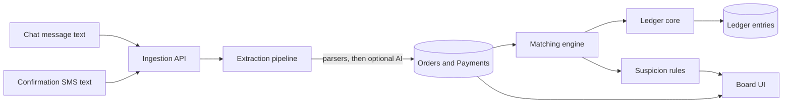

# Design: chat-ledger

## Overview

Java 21, Spring Boot, PostgreSQL. Server-rendered UI with Thymeleaf and HTMX, so the
page stays light on slow phones. The ledger is its own Maven module with no web
dependency, so it can be reused later.

## Architecture

## Modules

| Module | Responsibility | Depends on |
|---|---|---|
| `ledger-core` | Accounts, immutable entries, balance invariant, reversals | nothing |
| `ingestion` | Endpoints, idempotency, input validation, HMAC | `extraction` |
| `extraction` | Order parser, SMS templates, optional AI extractor, validator | nothing |
| `matching` | Scoring, thresholds, partial and over payments, overrides | `ledger-core` |
| `suspicion` | Rule set that produces flags with reasons | `matching` |
| `web` | Board, simulators, exports, auth | all |

## Data model (main tables)

- `tenant(id, name, currency, scale)`
- `app_user(id, tenant_id, email, password_hash, role)`
- `customer(id, tenant_id, display_name, phone_hash, phone_last4)`
- `orders(id, tenant_id, external_id UNIQUE per tenant, customer_id, total_minor, currency, status, raw_text, created_at)`
- `order_line(id, order_id, label, qty, unit_minor)`
- `payment(id, tenant_id, provider, tx_id UNIQUE per tenant+provider, amount_minor, currency, sender_name, sender_last4, paid_at, status, raw_text)`
- `match(id, order_id, payment_id, amount_minor, score, reasons_json, state, decided_by, decided_at)`
- `flag(id, tenant_id, subject_type, subject_id, code, reason, created_at, resolved_at)`
- `account(id, tenant_id, code, name, type)`
- `ledger_txn(id, tenant_id, kind, ref_type, ref_id, created_at)`
- `ledger_entry(id, txn_id, account_id, debit_minor, credit_minor)` with a check that one of the two is zero, and no UPDATE or DELETE allowed by the application role.
- `audit_log(id, tenant_id, actor, action, subject, at)`

Default accounts: Accounts receivable, Mobile money clearing, Sales revenue, Customer credit (overpayments).

## Order and payment states

- Order: `PENDING_PAYMENT`, `PARTIALLY_PAID`, `PAID`, `NEEDS_REVIEW`, `UNPARSED`, `CANCELLED`
- Payment: `RECEIVED`, `MATCHED`, `UNMATCHED`, `DUPLICATE`, `UNVERIFIED`, `UNPARSED`
- Match: `AUTO`, `SUGGESTED`, `CONFIRMED`, `REJECTED`, `REVERSED`

## Ledger postings

- Order accepted: debit Accounts receivable, credit Sales revenue.
- Payment matched: debit Mobile money clearing, credit Accounts receivable (up to the order balance).
- Excess: debit Mobile money clearing, credit Customer credit.
- Unmatch: a reversal transaction that mirrors the original, never an edit.

## Matching score (initial weights, tunable)

| Signal | Points |
|---|---|
| Amount equals order balance | 50 |
| Reference code in the confirmation equals the order code | 25 |
| Sender name similarity to customer (normalized, accent-insensitive) | 15 |
| Timestamp within the expected window after the order | 10 |

Thresholds: score >= 85 auto-match; 60 to 84 suggest; below 60 leave unmatched.
Every candidate keeps its list of reasons so the UI can say why.

## Extraction pipeline

1. Normalize text (whitespace, digits, accents, common separators).
2. Try each parser or template in order. First valid result wins.
3. If none match and an AI extractor is configured, call it with a timeout and a JSON schema.
4. Validate: amount appears in the source text, currency known, date plausible. Reject otherwise.
5. Never pass phone numbers or names to an external service unless the operator has enabled it.

The default deployment has no AI extractor. A free host cannot run a local model, so the
live demo relies on deterministic parsers. The AI extractor stays behind an interface
and can point at any compatible endpoint.

## Provider templates

Templates are data, not code: name, regex with named groups, field mapping, date format.
The demo ships two **synthetic** formats ("ProviderA", "ProviderB"). Real operator formats
can be added without a release. Do not copy real operator wording into the repository.

## API (JSON, signed)

- `POST /api/v1/messages/order` body: `externalId`, `text`
- `POST /api/v1/messages/payment` body: `externalId`, `text`
- `GET /api/v1/board`
- `POST /api/v1/matches/{id}/confirm`, `/reject`, `/reverse`
- `GET /api/v1/export/ledger.csv`

Headers: `X-Signature` (HMAC-SHA256 over the body), `X-Tenant`. Idempotency by `externalId`.

## Suspicion rules

Each rule is a small class returning zero or more flags with a code and a plain reason:
`DUPLICATE_TX`, `NO_PROVIDER_ID`, `AMOUNT_NEAR_MISS`, `NAME_MISMATCH`, `TIME_ANOMALY`,
`SENDER_ALIAS`. Rules are independent and individually testable.

## Security design

- Every repository method takes the tenant id. Tests prove that tenant A cannot read tenant B.
- Passwords hashed with a modern algorithm. Session cookies `HttpOnly`, `Secure`, `SameSite`.
- Phone numbers stored hashed with a per-tenant salt plus the last 4 digits for display.
- Output encoding on all templates. CSRF on forms. Strict content security policy.
- Body size limit and rate limit per tenant on ingestion.
- Secrets from environment variables only. A pre-commit secret scan.
- The demo tenant is read-write on synthetic data and reset on a schedule.

## Testing strategy

- Unit tests for parsers, scoring, and each suspicion rule, with a table of examples.
- **Property-based tests** (jqwik):
  - any sequence of postings leaves every transaction balanced;
  - applying the same message twice changes nothing (idempotency);
  - matching never assigns more than the payment amount or the order balance;
  - reversal followed by re-post returns to the same balances.
- Integration tests on PostgreSQL for tenant isolation and immutability.
- One end-to-end test per demo scenario.

## Deployment

Docker image, PostgreSQL, health endpoint, migrations with Flyway. Target a free
container host and confirm its limits (memory, sleep behavior) before the final week.
The demo credentials go in the Devpost testing field.

## Risks

- Real operator SMS formats vary: mitigated by data-driven templates.
- Free hosting may sleep: mention it in the testing notes and keep a short warm-up.
- Scope: the board, simulators, and ledger must work end to end before any extra feature.
